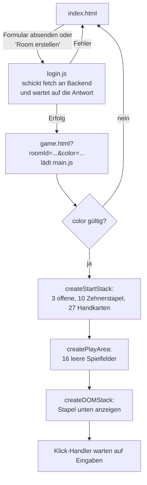

# Technische Dokumentation – Ligretto

> **Hinweis:** Diese Dokumentation wurde von einer KI (Claude) geschrieben und von Arun geprüft. Der Code stammt grösstenteils von Arun. Wer was gemacht hat, steht im Arbeitsprotokoll [Dokumentation.md](Dokumentation.md).

Diese Datei beschreibt den **aktuellen Aufbau** des Projekts: welche Dateien es gibt, was die Funktionen machen und wie sie zusammenspielen. Sie wird nur angepasst, wenn sich am Aufbau etwas ändert (siehe Abschnitt 12). Einzelne Änderungen und Bugfixes stehen im Änderungsprotokoll von `Dokumentation.md` und in der Git-Historie.

Stand: 21.11.2026

---

## 1. Überblick

Ligretto ist ein Kartenspiel für mehrere Spieler, das im Browser laufen soll. Jeder Spieler hat ein eigenes Deck mit 40 Karten und legt so schnell wie möglich Karten in aufsteigender Reihenfolge (1 bis 10, gleiche Farbe) auf gemeinsame Stapel in der Tischmitte.

**Aktueller Stand:**
- **Frontend:** Startseite und Spielseite für **einen** Spieler. Karten werden verteilt, angezeigt und nach den Regeln aufs Spielfeld gelegt.
- **Backend:** Python-Module für Kartenliste, Kartenverteilung, Spielregeln und Punktezählung. Dazu ein erster FastAPI-Server mit den Routen `/joinRoom`, `/createRoom` und `/createCards`, der Räume und die Startstapel im Arbeitsspeicher verwaltet. Das Frontend schickt beim Beitreten und Erstellen eine Anfrage und leitet nur bei Erfolg zur Spielseite weiter. Die Karten auf der Spielseite werden aber noch im Frontend verteilt, nicht vom Backend.

| Bereich | Technik |
|---|---|
| Frontend | HTML, CSS, JavaScript (ES-Module, ohne Framework) |
| Backend | Python 3.14, FastAPI (Server), Pydantic (Anfrage-Modelle), uvicorn (startet den Server) |
| Tests | pytest (geplant, im venv installiert) |

---

## 2. Projekt starten

**Frontend:** Weil die JavaScript-Dateien als ES-Module geladen werden, braucht es einen lokalen Webserver. Ein Doppelklick auf `index.html` funktioniert nicht.

```bash
cd frontend
python3 -m http.server 8000
```

Danach im Browser `http://localhost:8000` öffnen.

**Python-Umgebung (venv):**

```bash
python3 -m venv .venv          # nur einmal, falls .venv fehlt
source .venv/bin/activate      # bei jeder neuen Terminal-Sitzung
pip install -r requirements.txt
```

**Backend-Server**, im Projektordner (nicht in `backend/`) mit aktivem venv, damit die Imports mit `backend.` funktionieren:

```bash
uvicorn backend.connection.routes:app
```

`uvicorn` nimmt standardmässig Port 8000, also denselben wie das Frontend oben. Siehe BUG-017 in [Bugs.md](Bugs.md).

**Tests** (sobald vorhanden), im Projektordner mit aktivem venv:

```bash
python3 -m pytest
```

---

## 3. Projektstruktur

```
Ligretto/
├── README.md                  Kurzbeschreibung für Besucher
├── AGENTS.md                  Regeln für KI-Agenten
├── .gitignore                 venv, Caches, .DS_Store usw. werden nicht gepusht
├── .venv/                     virtuelle Python-Umgebung (lokal, nicht im Repo)
├── Dokumentation/
│   ├── Dokumentation.md       Arbeitsprotokoll und Änderungsprotokoll
│   ├── Technische-Doku.md     diese Datei
│   └── Bugs.md                offene Bugs
├── backend/
│   ├── memory.py              alle 160 Karten, erlaubte Farben und offene Räume (im Arbeitsspeicher)
│   ├── connection/
│   │   ├── model.py           Pydantic-Modelle für den JSON-Body der Anfragen
│   │   └── routes.py          FastAPI-App mit /joinRoom, /createRoom und /createCards
│   ├── logic/
│   │   ├── createRoomId.py    zufällige 6-stellige RoomID
│   │   ├── shuffle.py         Karten eines Spielers mischen und verteilen
│   │   ├── rules.py           Spielregeln
│   │   └── winner.py          Punkte zählen und Gewinner bestimmen
│   └── test/
│       └── connection.py      für Tests der Routen (noch leer)
└── frontend/
    ├── index.html             Startseite (Room beitreten / erstellen)
    ├── login.js               Logik der Startseite
    ├── login.css              Styles der Startseite
    ├── game.html              Spielseite
    ├── main.js                Einstiegspunkt der Spielseite, Klick-Handler
    ├── create-stack.js        Kartendaten, Startstapel, Aufbau im DOM
    ├── move-cards.js          Karten verschieben, Stapel-Arrays pflegen
    ├── rules.js               Spielregeln
    ├── styles.css             gemeinsames Layout (Header, Footer, 3×3-Raster)
    ├── game.css               Layout der Spielerbereiche
    ├── rules.html             Regelseite (noch leer)
    └── images/                Kartenbilder, je Farbe ein Ordner, Rückseiten in back/
```

---

## 4. Ablauf



1. **Startseite:** Der Spieler gibt eine RoomID ein und wählt eine Kartenfarbe. `login.js` schickt eine Anfrage an `/joinRoom` bzw. `/createRoom` (Abschnitt 9.6) und wartet mit `await` auf die Antwort. Nur bei Erfolg (`response.ok`) geht es weiter zu `game.html`. RoomID (aus der Antwort des Backends) und Farbe werden als URL-Parameter übergeben: `game.html?roomId=...&color=...`. Bei einem Fehler bleibt der Spieler auf der Startseite, eine Meldung gibt es noch nicht.
2. **Spielseite:** `main.js` liest `color` und `roomId` mit `URLSearchParams` aus der URL. `roomId` wird noch nicht verwendet. Ist die Farbe ungültig, erscheint eine Meldung und der Spieler kommt zurück zur Startseite.
3. **Aufbau:** Die Karten werden verteilt, das Spielfeld und die eigenen Stapel werden im DOM erzeugt.
4. **Spielen:** Karte anklicken (grüner Rahmen) und dann ein Ziel anklicken (siehe Abschnitt 7).

---

## 5. Datenmodell

### 5.1 Karte

Jede Karte ist ein Objekt (JavaScript) bzw. ein Dictionary (Python) mit denselben Feldern:

| Feld | Beispiel | Bedeutung |
|---|---|---|
| `id` | `"yellow-green-5"` | eindeutig, Format `besitzer-farbe-wert` |
| `owner` | `"yellow"` | wem die Karte gehört (Farbe der Rückseite) |
| `color` | `"green"` | Farbe der Vorderseite, für die Regeln wichtig |
| `value` | `5` | Wert 1 bis 10 |
| `alt` | `"Grün 5"` | Alternativtext des Bildes |
| `src` | `"images/green/five.PNG"` | Bild der Vorderseite |
| `back` | `"images/back/yellow.PNG"` | Bild der Rückseite |

Es gibt 4 Besitzer × 4 Farben × 10 Werte = **160 Karten**. Die Liste steht zweimal im Projekt: als `CARDS` in `frontend/create-stack.js` und in `backend/memory.py`.

### 5.2 IDs im DOM

| Element | ID / Klasse | Beispiel |
|---|---|---|
| Kartenbild | ID `image` + Karten-ID | `imageyellow-green-5` |
| offener Kartenplatz | ID `openCard` + Karten-ID, Klasse `openCardsElement` | `openCardyellow-green-5` |
| Bild einer offenen Karte | Klasse `openCardImage` | |
| Zehnerstapel-Container | ID `tenStackDiv` + Farbe, Klasse `tenStackElement` | `tenStackDivyellow` |
| Karte im Zehnerstapel | Klasse `tenStackImage` | |
| Handkarten-Container | ID `handCardsDiv` + Farbe, Klasse `handCardsElement` | |
| Spielfeld-Feld | ID `playAreaField0` bis `playAreaField15`, Klasse `playAreaField` | |

Das Präfix `image` ist wichtig: Die Regel-Funktionen im Frontend (`getNumber`, `getColor`) schneiden die ersten 5 Zeichen ab, um die Karten-ID zu erhalten. Das Backend arbeitet dagegen mit Karten-IDs **ohne** Präfix (siehe 9.3).

### 5.3 Stapel-Arrays im Frontend

| Array | Ort | Inhalt |
|---|---|---|
| `openCards` | `playerStartStacks` in `main.js` | offene Karten des Spielers |
| `tenStack` | `playerStartStacks` in `main.js` | Zehnerstapel, `tenStack[0]` liegt oben |
| `handCards` | `playerStartStacks` in `main.js` | verdeckte Handkarten |
| `laidCards` | exportiert aus `move-cards.js` | alle Karten auf dem Spielfeld, auch überdeckte |

Wenn eine Karte gelegt wird, verschwindet sie aus ihrem Stapel-Array und kommt in `laidCards`. Die Ausnahme ist das Nachfüllen: Eine Karte vom Zehnerstapel auf einem leeren offenen Platz kommt in `openCards`.

---

## 6. Frontend-Module

### 6.1 `login.js` (Startseite)

| Funktion | Beschreibung |
|---|---|
| `getSubmitValues()` | liest RoomID und Farbe aus dem Formular, gibt `{ color, roomId }` zurück |
| `createRoom(roomId, color)` | leitet zu `game.html?roomId=...&color=...` weiter (Werte mit `encodeURIComponent`) |
| `joinRoom(roomId, color)` | leitet zu `game.html?roomId=...&color=...` weiter (Werte mit `encodeURIComponent`) |

Beide Listener sind `async` und schicken per `POST` JSON ans Backend: „Beitreten“ schickt `{ color, roomId }` an `http://localhost:8000/joinRoom`, „Erstelle einen neuen Room“ schickt nur `{ color }` an `http://localhost:8000/createRoom`. Ist `response.ok`, wird die Antwort `{ roomId, color }` gelesen und `joinRoom()` bzw. `createRoom()` mit der RoomID aus der Antwort aufgerufen. Bei einem Fehler gibt „Beitreten“ die Antwort nur mit `console.log` aus, „Erstellen“ macht nichts. `login.js` verwendet kein `sessionStorage` mehr.

### 6.2 `create-stack.js` (Daten und Aufbau)

| Funktion | Beschreibung |
|---|---|
| `CARDS` | Liste aller 160 Karten (exportiert) |
| `getDeck(owner)` | gibt die 40 Karten eines Spielers zurück. Bei ungültiger Farbe: Meldung, Weiterleitung zu `index.html`, Rückgabe `false` |
| `createStartStack(owner)` | wählt 3 offene und 10 Zehnerstapel-Karten zufällig, mischt die restlichen 27 Handkarten. Gibt `{ openCards, tenStack, handCards }` zurück, bei ungültiger Farbe `false` |
| `createDOMStack(openCards, tenStack, handCards)` | zeigt die Stapel im unteren Spielerbereich an. Der Zehnerstapel liegt versetzt übereinander (2,5 px pro Karte), nur die oberste Karte ist klickbar (`pointerEvents`). Die Handkarten zeigen die Rückseite in der Spielerfarbe. Die Farbe liest die Funktion selbst aus `sessionStorage` (`playerColor`), nicht aus der URL |
| `createPlayArea()` | erzeugt in `#playArea` ein 4 × 4-Raster mit 16 leeren Feldern (`playAreaField`) |

### 6.3 `move-cards.js` (Karten verschieben)

| Funktion | Beschreibung |
|---|---|
| `laidCards` | Array aller gelegten Karten (exportiert) |
| `getOldLocation(card, tenStack, openCards, handCards)` | intern: gibt `"tenStack"` zurück, wenn die Karte vom Zehnerstapel kommt, sonst das passende Array |
| `deleteFromStack(card, openCards, tenStack, handCards, newLocation)` | entfernt die Karte aus ihrem Stapel-Array. Zehnerstapel → offener Platz: in `openCards`, sonst in `laidCards` |
| `moveCardsToPlayArea(card, newLocation, openCards, tenStack, handCards)` | hängt das Kartenbild ins Ziel-Element und ruft `deleteFromStack()` auf. Kam die Karte vom Zehnerstapel, wird die nächste Karte darunter klickbar |
| `clickCardStyle(lastCard)` | setzt den Rahmen der zuvor ausgewählten Karte auf schwarz zurück |

### 6.4 `rules.js` (Spielregeln)

| Funktion | Beschreibung |
|---|---|
| `getNumber(card)` | Wert der Karte (1 bis 10), `undefined` bei unbekannter Karte |
| `getColor(card)` | Farbe der Karte, `undefined` bei unbekannter Karte |
| `isAllowed(targetCard, currentCard)` | `true`, wenn `currentCard` auf `targetCard` gelegt werden darf (siehe Abschnitt 8). `targetCard` darf `null` sein (leeres Feld) |

### 6.5 `main.js` (Einstiegspunkt)

Startet nach `DOMContentLoaded`, liest `color` und `roomId` aus den URL-Parametern, prüft die Spielerfarbe und baut die Seite auf (siehe Abschnitt 4). Der Button „Anderem Raum beitreten“ (`#joinOtherRoom`) führt zurück zu `index.html`. Der Spielzustand liegt in zwei Variablen:

| Variable | Bedeutung |
|---|---|
| `activeField` | aktuell ausgewählte Karte (`img`), `null` = keine Auswahl |
| `lastCard` | vorherige Auswahl, damit ihr grüner Rahmen zurückgesetzt werden kann |

Die Klick-Handler sind in Abschnitt 7 beschrieben.

---

## 7. Interaktion: Karte auswählen und legen

Ein Zug besteht immer aus zwei Klicks: **Karte auswählen** (grüner Rahmen) und **Ziel anklicken**.

| Klick auf | Bedingung | Ergebnis |
|---|---|---|
| oberste Karte im Zehnerstapel | – | Karte wird ausgewählt |
| offene Karte | keine Zehnerstapel-Karte ausgewählt | offene Karte wird ausgewählt |
| belegter offener Platz | Zehnerstapel-Karte ausgewählt | stattdessen wird diese offene Karte ausgewählt |
| leerer offener Platz | Zehnerstapel-Karte ausgewählt | **Nachfüllen:** Karte wandert auf den Platz und in `openCards` |
| Spielfeld (Feld oder Karte) | keine Karte ausgewählt | nichts passiert |
| leeres Spielfeld-Feld | ausgewählte Karte ist eine 1 | Karte wird gelegt, Auswahl aufgehoben |
| leeres Spielfeld-Feld | ausgewählte Karte ist keine 1 | nichts passiert, Auswahl bleibt |
| Karte im Spielfeld | `isAllowed()` ist `true` | alte Karte wird aus dem DOM entfernt (bleibt in `laidCards`), neue Karte liegt im Feld, Auswahl aufgehoben |
| Karte im Spielfeld | `isAllowed()` ist `false` | nichts passiert, Auswahl bleibt |

Im DOM liegt pro Spielfeld-Feld immer nur die oberste Karte. Die überdeckten Karten stehen nur noch in `laidCards`.

---

## 8. Spielregeln

Umgesetzt in `frontend/rules.js` und gleich in `backend/logic/rules.py`:

1. Auf ein **leeres Feld** darf nur eine **1** gelegt werden.
2. Auf eine **Karte** darf nur eine Karte mit **gleicher Farbe** und einem **genau um 1 höheren Wert** gelegt werden (z. B. Grün 4 auf Grün 3).

Punktezählung (nur im Backend, `backend/logic/winner.py`): Jede gelegte Karte gibt ihrem Besitzer 1 Punkt, jede Karte, die noch im Zehnerstapel liegt, 2 Punkte Abzug. Gewonnen hat die Farbe mit den meisten Punkten, bei Gleichstand mehrere.

Noch nicht umgesetzt: Handkarten aufdecken und spielen, Spielende („Ligretto!“ bei leerem Zehnerstapel).

---

## 9. Backend-Module

Die Module in `logic/` sind reine Funktionen ohne Server. Sie bekommen die Kartenliste als Parameter `CARDS` und importieren sie nicht selbst. Dadurch lassen sie sich mit einer eigenen, kleinen Kartenliste testen.

### 9.1 `backend/memory.py`

Zentraler Speicher des Backends, nur im Arbeitsspeicher. Beim Neustart des Servers sind alle Räume weg.

| Variable | Typ | Inhalt |
|---|---|---|
| `CARDS` | Liste | alle 160 Karten, gleicher Aufbau wie im Frontend (Abschnitt 5.1) |
| `acceptedColors` | Liste | erlaubte Spielerfarben: `"pink"`, `"yellow"`, `"green"`, `"blue"` (gleich wie die `<option>`-Werte in `index.html`) |
| `rooms` | Dictionary | RoomID (String) → Daten eines Raums. Enthält zum Testen die zwei Beispielräume `123456` (Blau, Pink) und `654321` (Blau, Grün) |

Jeder Raum in `rooms` hat diesen Aufbau:

| Schlüssel | Typ | Inhalt |
|---|---|---|
| `playerColors` | Liste | Farben der Spieler in diesem Raum, jede Farbe nur einmal |
| `laidCards` | Liste | alle in der Mitte gelegten Karten (Karten-Dictionaries) |
| `tenStack` | Dictionary | Farbe → Anzahl Karten im Ligretto-Stapel, startet bei `10`, z. B. `{"blue": 8, "pink": 10}`. Wird von `create_room()` und `join_room()` angelegt, die Beispielräume haben ihn nicht |
| `stacks` | Dictionary | Farbe → `{ "tenStack": [...], "openCards": [...], "handCards": [...] }`. Wird von `create_cards()` angelegt, die Beispielräume haben ihn von Anfang an |

In den Beispielräumen stehen in `stacks` Karten-IDs (z. B. `"blue-green-7"`, die letzte ID ist die oberste Karte). `create_cards()` speichert dagegen ganze Karten-Dictionaries aus `CARDS`.

Damit passen `playerColors`, `laidCards` und `tenStack` eines Raums direkt als Parameter zu `countCards()` (Abschnitt 9.4).

### 9.2 `backend/logic/shuffle.py`

| Funktion | Beschreibung |
|---|---|
| `getPlayerCards(CARDS, playerColor)` | alle Karten mit `owner == playerColor`, `False` bei unbekannter Farbe |
| `shuffleDeck(CARDS, playerColor)` | die Karten des Spielers, gemischt. `False` bei unbekannter Farbe |
| `getDivideStack(CARDS, playerColor)` | gibt das Tupel `(tenStack, openCards, handCards)` mit 10/3/27 Karten zurück. Bei unbekannter Farbe: `ValueError("Player color unknown")` |

**Achtung:** Die Reihenfolge der Rückgabe ist eine andere als im Frontend. `createStartStack()` gibt `{ openCards, tenStack, handCards }` zurück, `getDivideStack()` gibt `(tenStack, openCards, handCards)` zurück.

### 9.3 `backend/logic/rules.py`

| Funktion | Beschreibung |
|---|---|
| `getId(card)` | gibt die Karten-ID unverändert zurück |
| `getNumber(card, CARDS)` | Wert der Karte, `0` bei unbekannter Karte |
| `getColor(card, CARDS)` | Farbe der Karte, `""` bei unbekannter Karte |
| `isAllowed(targetCard, currentCard, CARDS)` | gleiche Regeln wie im Frontend, `targetCard` darf `None` sein |

Die Funktionen erwarten Karten-IDs **ohne** Präfix `image`, also wie in `memory.py` (z. B. `"blue-blue-1"`). Schickt das Frontend später seine DOM-IDs, muss das Präfix vorher entfernt werden.

### 9.4 `backend/logic/winner.py`

| Funktion | Beschreibung |
|---|---|
| `countCards(laidCards, playerColors, tenStack)` | zählt pro Farbe aus `playerColors` die Karten in `laidCards` mit diesem Besitzer (`owner`) und zieht pro Karte im Zehnerstapel 2 ab. Gibt ein Dictionary „Farbe → Punkte“ zurück, dazu den Schlüssel `"winner"` mit der Liste der Farben mit den meisten Punkten |

`tenStack` muss für jede Farbe aus `playerColors` einen Eintrag haben, auch mit `0`. Fehlt einer, kommt `ValueError("Ten stack missing for <Farbe>")`. Ist `playerColors` leer, kommt `ValueError("No player colors")`. Zusätzliche Farben in `tenStack` werden ignoriert.

### 9.5 `backend/logic/createRoomId.py`

| Funktion | Beschreibung |
|---|---|
| `createRoomID()` | gibt eine zufällige RoomID aus 6 Ziffern als String zurück (mit `secrets`). Prüft nicht, ob sie schon vergeben ist |

### 9.6 `backend/connection/` (Server)

Start: `uvicorn backend.connection.routes:app` im Projektordner (Abschnitt 2).

**`model.py`** – Pydantic-Modelle für den JSON-Body. Fehlt ein Feld oder hat es den falschen Typ, antwortet FastAPI automatisch mit `422`.

| Klasse | Felder |
|---|---|
| `roomRequestBase` | `color: str` |
| `joinRoomRequest` | erbt von `roomRequestBase`, dazu `roomId: str` |
| `createCards` | `roomId: str` |

**`routes.py`** – FastAPI-App `app`:

| Route | Funktion | Body | Erfolg | Fehler |
|---|---|---|---|---|
| `POST /joinRoom` | `join_room(data)` | `joinRoomRequest` | `200` `{ roomId, color }`, Farbe wird in `playerColors` eingetragen, `tenStack[color] = 10` | `400` leere Eingabe oder Farbe nicht in `acceptedColors`, `404` Raum nicht gefunden, `409` Farbe im Raum schon vergeben |
| `POST /createRoom` | `create_room(data)` | `roomRequestBase` | `200` `{ roomId, color }` mit neuer RoomID, Raum wird in `rooms` angelegt | `400` leere Farbe oder Farbe nicht in `acceptedColors` |
| `POST /createCards` | `create_cards(data)` | `createCards` | `200` `{ stacks }`: für jede Farbe in `playerColors` die mit `getDivideStack()` gemischten Stapel `tenStack` (10), `openCards` (3) und `handCards` (27), gespeichert unter `rooms[roomId]["stacks"]` | `404` Raum nicht gefunden |

`create_room()` erzeugt die RoomID selbst mit `createRoomID()` und würfelt neu, solange sie schon in `rooms` vorkommt. Eine mitgeschickte `roomId` wird ignoriert.

`create_cards()` überschreibt bei jedem Aufruf die Stapel aller Spieler im Raum. Das Frontend ruft die Route noch nicht auf.

**`backend/test/connection.py`** – für Tests der Routen vorgesehen, noch leer.

---

## 10. Layout

- `styles.css` teilt `main` in ein **3 × 3-Raster**. Die Mitte ist breit und enthält das Spielfeld, die vier Ränder sind für die Spieler (oben, links, rechts, unten).
- `game.css` ordnet die Spielerbereiche im Raster an. Oben und unten liegen die Elemente nebeneinander, links und rechts untereinander.
- Jeder Spielerbereich (`playerDeck…`) hat vier Container: offene Karten, Zehnerstapel, verdeckte Handkarten, aufgedeckte Handkarten.
- Bisher wird nur der **untere** Bereich (`…Bottom`) befüllt, das ist der eigene Spieler.
- Kartenbilder sind 60 × 90 px gross und haben einen Rahmen von 2 px.

---

## 11. Bekannte Einschränkungen

- Der Server verwaltet Räume und kann Startstapel verteilen (`/createCards`). Spielzüge und Positionen werden noch nicht übertragen, die Spielseite verteilt die Karten weiterhin selbst. Es gibt noch kein echtes Multiplayer.
- Das Frontend wertet beim Beitreten und Erstellen nur aus, ob die Anfrage erfolgreich war. Fehlermeldungen werden dem Spieler noch nicht angezeigt.
- Die RoomID steht auf der Spielseite nur in der URL, sie wird nirgends angezeigt.
- Räume liegen nur im Arbeitsspeicher (`memory.rooms`) und werden nie gelöscht.
- Nur der eigene Spieler (unten) wird angezeigt. Die Bereiche oben, links und rechts sind leer.
- Die Handkarten sind noch nicht klickbar, und `handCards…Open` wird noch nicht benutzt.
- `rules.html` ist leer.
- Kartenliste und Regeln gibt es doppelt, im Frontend (JavaScript) und im Backend (Python). Ändert sich etwas, müssen beide Stellen angepasst werden.
- `game.html` lädt `create-stack.js` und `move-cards.js` zusätzlich direkt. Das ist harmlos, weil `main.js` sie sowieso importiert.

Offene Bugs stehen in [Bugs.md](Bugs.md).

---

## 12. Pflege dieser Datei

Diese Datei wird **nur** angepasst, wenn sich der Aufbau ändert:
- eine Datei oder ein Ordner kommt dazu, wird umbenannt oder gelöscht
- eine Funktion kommt dazu, wird umbenannt oder gelöscht
- Parameter oder Rückgabewerte einer Funktion ändern sich
- der Ablauf ändert sich (z. B. wenn Frontend und Backend verbunden werden)
- Datenmodell, IDs oder Spielregeln ändern sich

Bugfixes ohne Auswirkung auf den Aufbau ändern diese Datei nicht. Die Regel dazu steht in `AGENTS.md`, Abschnitt 8.
